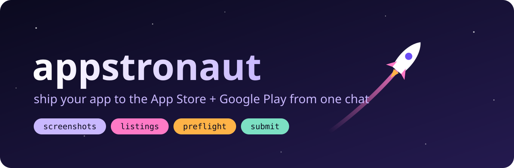

<p align="center">
  
</p>

<p align="center">
  <a href="LICENSE"></a>
  
  
  
</p>

# appstronaut 🧑‍🚀

**Store submission, but make it one chat.**

appstronaut is an agent skill for Claude Code, Codex, Cursor, Gemini CLI and Copilot that takes a mobile app from
"it runs on my phone" to **in review on the App Store and Google Play**. It asks its questions
once, then handles the rest: screenshots, listings, privacy forms, age ratings, reviewer
notes, builds, uploads and the submit. It only stops for the things a robot shouldn't do for
you: passwords, legal agreements, 2FA, and the final "yes, send it" (unless you opt into
auto-submit).

It also carries a **rejection catalogue** from real launches. Every past rejection became a
check that runs *before* a reviewer sees your app. Guideline 3.2, 5.1.1(ii), a privacy URL that
serves an empty SPA shell to crawlers: preflight catches them all.

> Honest take: store consoles are a boss fight with 40 health bars. This is the walkthrough.

---

## ✨ What it does

| | |
|---|---|
| 🎤 **Asks once** | About 12 questions in 3 rounds, pre-filled from your repo. After that it runs unattended. |
| 🔍 **Reads your code, not your memory** | Permissions, SDKs, data collected and tablet support come from the manifest and source, so your privacy labels match the binary. |
| 🛫 **Preflight** | 92 known failure modes; the automatable ones run as `preflight.mjs`: dead URLs, JS-only privacy pages, `$(PRODUCT_NAME)` purpose strings, icons with alpha, duplicate React, paywall strings, a reviewer login that doesn't work on production… |
| 📸 **Screenshots** | Boots simulators and emulators **one at a time**, drives your app with [Maestro](https://maestro.mobile.dev) (adb fallback for moody Android emulators), fakes a clean 9:41 status bar, and saves every required size into your project. |
| 📝 **Fills the consoles through APIs** | App Store Connect API and the Google Play Developer API: listing, categories, age rating, pricing, availability, review details, screenshots in the right order, data safety. Dry run first, always. |
| 🧭 **Browser only for the gaps** | Creating app records, App Privacy and Play App content aren't in any API. A step-by-step guide covers those, including the order Play Console quietly requires. |
| 🏗️ **Builds** | EAS cloud or local, Flutter, Xcode, Gradle. Includes fixes for the classic traps (exFAT drives, same-name signing certs, empty build quota). |
| 🚀 **Releases** | `release.mjs`: preflight gate → validate + upload → wait for processing → attach → submit. It refuses to auto-submit into a rejection it can already see. |

## 🗺️ The pipeline

```
A Intake ─▶ B Profile ─▶ C Preflight ─▶ D Assets ─▶ E API fill ─▶ F Browser fill ─▶ G Build ─▶ H Preflight (submit) ─▶ I Release ─▶ J Handoff
```

Progress is saved to `store-assets/launch-state.json`, so if your laptop dies mid-launch
(it happens), the next session picks up where it stopped.

Prefer a slower pace? There's also a **staged wizard** (accounts → detect → requirements →
build → test → screenshots → store content → production) with options at every step.

## 🚀 Install — works in every major coding agent

It's a standard [Agent Skill](https://agentskills.io) (`SKILL.md` + scripts), so one install
covers them all:

```bash
git clone https://github.com/neetu-ai-dev/appstronaut.git
cd appstronaut && ./install.sh          # --project for one repo only, --copy to copy instead of link
```

That links the skill into `~/.claude/skills` and `~/.agents/skills`. `git pull` updates it.

| Agent | Reads the skill from | Start it |
|---|---|---|
| **Claude Code** | `~/.claude/skills` (or the plugin below) | `/appstronaut` |
| **Codex CLI** | `~/.agents/skills` | `$appstronaut` |
| **Cursor** | `~/.agents/skills` | `/appstronaut` |
| **Gemini CLI** | `~/.agents/skills` | just ask; approve the skill when prompted |
| **GitHub Copilot** | `~/.agents/skills` | just ask in agent mode |

Or just say *"get this app on both stores"*. Every agent picks the skill up from its description.

**Claude Code plugin, if you prefer:**

```
/plugin marketplace add neetu-ai-dev/appstronaut
/plugin install appstronaut@appstronaut-marketplace
```

> **macOS only for now.** iOS simulators, Xcode and Apple's upload tools only run on macOS.
> Windows and Linux support is on the roadmap.

## 🧰 What you need

| For | Needs |
|---|---|
| Screenshots | macOS, Xcode (iOS simulators), Android SDK + emulator, [Maestro](https://maestro.mobile.dev), Java 17 |
| Store scripts | Node 18+ (no npm install; zero dependencies) |
| Builds | `eas-cli` for Expo, or Xcode / Gradle / `flutter` |
| Apple API | An App Store Connect API key (`.p8`) |
| Google API | A Play service-account JSON, invited under **Users and permissions** |
| Accounts | Apple Developer Program (99 USD/yr) and Google Play Console (25 USD once) |

Credentials come from **env only** (`ASC_KEY_ID`, `ASC_ISSUER_ID`, `ASC_KEY_FILE`,
`PLAY_KEY_FILE`). They never go in the repo or the config. Reviewer passwords are typed by you,
never written to disk.

## 🕹️ Run the scripts yourself

Everything reads one file, `store-assets/store-config.json` (schema in
[`intake.md`](skills/appstronaut/intake.md)).

```bash
S=skills/appstronaut/scripts/store

node $S/preflight.mjs --stage setup                 # what would get you rejected
node $S/asc-fill.mjs                                # dry run: prints what it WOULD change
node $S/asc-fill.mjs --apply --screenshots          # actually fill App Store Connect
node $S/play-fill.mjs --apply --images              # same for Google Play
node $S/preflight.mjs --stage submit                # site, API and reviewer login must be live
node $S/release.mjs --ipa app.ipa --aab app.aab     # upload + attach, then stop
node $S/release.mjs --ipa app.ipa --aab app.aab --submit   # …and send for review
```

## 🙅 What it won't do (on purpose)

- Type your passwords, accept legal terms for you, or pass 2FA.
- Submit for review unless you said so (`--submit`, or `"autoSubmit": true` in the config).
- Submit while submit-stage preflight is red.
- Put real customer data in screenshots or listings. Use a fictional demo tenant, and list
  names that must never appear in `forbiddenNames`.
- Skip Google's one-time rule: a brand-new app's first AAB and first rollout happen in
  Play Console by hand. After that it's automatic.

## 📚 What's inside

```
install.sh                      one install for every agent
AGENTS.md                       notes for agents working on this repo
skills/appstronaut/
  SKILL.md                      the brain: pipeline + staged wizard + tool map for any agent
  intake.md                     the questions + store-config.json schema
  rejection-catalogue.md        92 failure modes → the check for each
  console-browser.md            the console-only clicks, in the order the consoles need
  account-setup.md              enrollment, individual vs org, D-U-N-S, the 12-tester rule
  build-submit.md               EAS / local / native builds and their traps
  testing-release.md            TestFlight, Play tracks, production
  android-screenshots-fallback.md   when Maestro and the emulator don't get along
  scripts/
    detect.sh  devices.sh  capture.sh          detect the project, set up devices, capture
    requirements/                              every size + field, per store
    store/  lib.mjs  asc-fill.mjs  play-fill.mjs  preflight.mjs  release.mjs
  flows/
    example.yaml                               Maestro starter
    login-tabs-example/                        a complete, working capture rig
```

## ⚠️ Heads up

- Store consoles change constantly. The skill tells Claude to re-check Apple's and Google's
  live spec pages before quoting a fee, size or button label, and to write any drift back into
  the docs.
- The pipeline makes real changes to real store records. Read the dry-run output before
  `--apply`. Uploads replace existing screenshot sets.
- Not affiliated with Apple, Google, Anthropic, OpenAI, Cursor or GitHub. App Store and Google Play are trademarks of
  their owners.

## 🤝 Contributing

Got rejected for something that isn't in the catalogue? That's the most valuable PR you can
send. Add a row to [`rejection-catalogue.md`](skills/appstronaut/rejection-catalogue.md) with
the guideline, what the reviewer said, and the check that would have caught it. Leave out
client names and app IDs.

Bugs and ideas → [issues](https://github.com/neetu-ai-dev/appstronaut/issues).

## License

[MIT](LICENSE) © 2026 Deepak Bisht
